<p align="center">
  <picture>
    <source media="(prefers-color-scheme: dark)" srcset="docs/brand/banner-dark.png">
    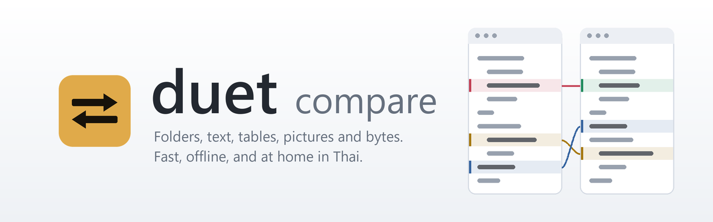
  </picture>
</p>

<p align="center">
  <b>English</b> · <a href="README.th.md">ภาษาไทย</a>
</p>

<p align="center">
  <b>duet compare is a fast, offline compare tool for Windows: folders, text, tables, pictures and raw bytes, side by side.</b><br>
  See what changed between two releases, two configs or two folders at a glance, merge three versions,<br>
  sync what you choose, and hand your team a report. Nothing ever leaves your computer.
</p>

<p align="center">
  
  
  
  
  <a href="LICENSE"></a>
  
</p>

<p align="center">
  <a href="https://github.com/ball46/duet/releases/latest"><b>⬇ Download for Windows</b></a> ·
  <a href="#report-a-bug-or-ask-for-a-feature">Report a bug</a> ·
  <a href="#report-a-bug-or-ask-for-a-feature">Ask for a feature</a> ·
  <a href="#build-from-source">Build from source</a>
</p>

<br>

<p align="center">
  <picture>
    <source media="(prefers-color-scheme: dark)" srcset="docs/images/text-dark.png">
    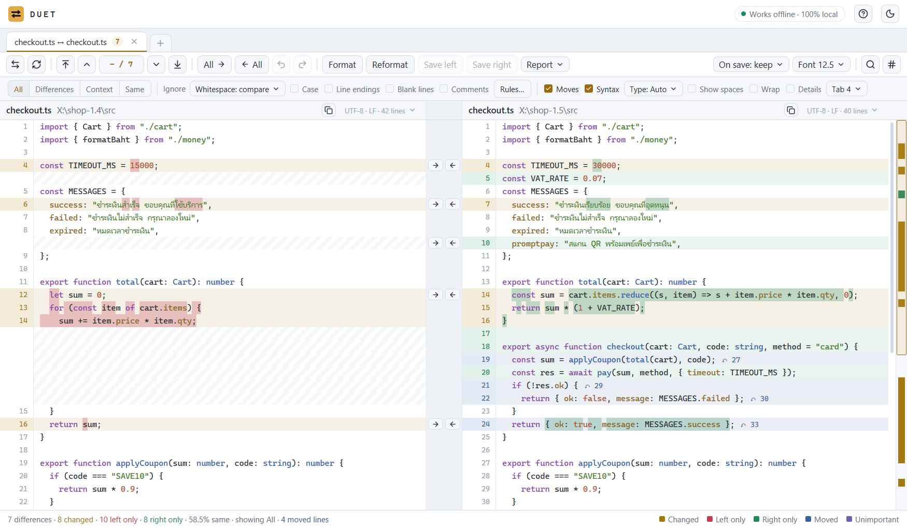
  </picture>
  <br>
  <sub>Two releases of the same file: amber for changed lines (with the changed characters marked), red and green for lines on one side only, blue for code that moved.</sub>
</p>

<p align="center">
  <a href="#why-duet">Why duet</a> ·
  <a href="#what-it-compares">What it compares</a> ·
  <a href="#reports-you-can-hand-to-someone">Reports</a> ·
  <a href="#details-that-save-you-a-bad-day">Details</a> ·
  <a href="#download-and-install">Install</a> ·
  <a href="#command-line">Command line</a> ·
  <a href="#report-a-bug-or-ask-for-a-feature">Issues</a> ·
  <a href="#faq">FAQ</a>
</p>

<br>

<table>
  <tr>
    <td width="25%" valign="top">
      <h3>📁 Folders</h3>
      Compare two trees by time, size or content. Filter, copy, delete to the Recycle Bin, and sync with a preview of every step before anything happens.
    </td>
    <td width="25%" valign="top">
      <h3>📝 Text</h3>
      Line and character differences, moved lines, rules for what does not matter, editing with undo, and 3-way merge with conflict handling.
    </td>
    <td width="25%" valign="top">
      <h3>🧮 Tables, pictures, bytes</h3>
      CSV and TSV cell by cell with key columns, pictures pixel by pixel with four views, and binary files of any size in hex.
    </td>
    <td width="25%" valign="top">
      <h3>🔒 Offline, fast, Thai-ready</h3>
      No network code at all. Opens big files quickly, reads Thai in UTF-8 or windows-874, and ships its guide in Thai and English.
    </td>
  </tr>
</table>

## Why duet

I used **Beyond Compare** every day at work and wanted to use that kind of tool to the full: folders, text,
tables, pictures and bytes in one place, the way I actually work. So I built duet from scratch,
based on that daily use, and added the things I kept wishing for, so a
compare is **easier to do and clearer to read**:

- **Fewer false alarms.** Files that differ only in line endings or a BOM show as **≈** and count as the same. Hover to see which side has which format.
- **The traps you cannot see.** A Linux script saved with Windows line endings is flagged **⚠** because it may not run. No-break spaces, zero-width characters and direction marks are marked **⍽** and **◇** and counted, in a file and across a whole folder.
- **Names that clash on Linux.** `Config.xml` and `config.xml` are one file on Windows and two on Linux; duet pairs them and warns you.
- **Moves, not just deletes.** A block that moved shows in blue with the line number on the other side. Click to jump there, drag to move it.
- **Reports you can share.** HTML, Excel, text and CSV, with your own names for each side (say *UAT* and *PROD*), and values that look like passwords or private keys masked before the report leaves your team.
- **A sync you can read first.** Every copy and delete is listed before you press Start, and deletes go to the Recycle Bin.
- **Thai, properly.** Thai text in UTF-8 or windows-874 is detected and shown correctly, and the built-in guide reads in Thai or English.

**Where the name comes from.** A duet is two performers on one piece of music. That is the idea of this
tool: it sets two sides next to each other, so you see at once where they part ways. The full name is
**duet compare**, so it says what it does, and the command stays short: `duet LEFT RIGHT`.

> [!NOTE]
> duet is an independent open-source project, written from scratch. It is not affiliated with,
> endorsed by or connected to Scooter Software, and contains no Beyond Compare code.
> Beyond Compare is a trademark of Scooter Software.

## What it compares

duet picks the view itself: two folders open a folder compare, two pictures a picture compare,
binary files the hex view, and anything else the text compare. Drop two items anywhere on the window,
type two paths, or pick a tile on the Start tab.

<p align="center">
  <picture>
    <source media="(prefers-color-scheme: dark)" srcset="docs/images/home-dark.png">
    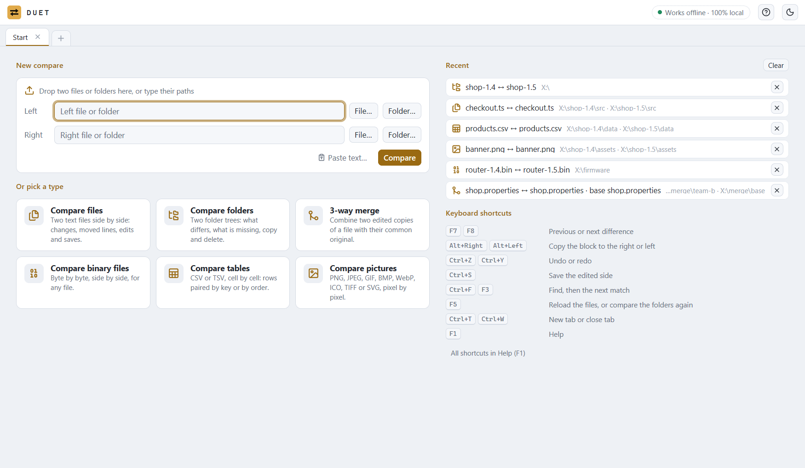
  </picture>
</p>

### Folders

<p align="center">
  <picture>
    <source media="(prefers-color-scheme: dark)" srcset="docs/images/folder-dark.png">
    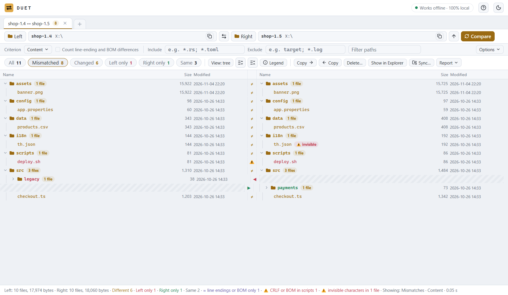
  </picture>
</p>

- Four ways to decide two files match: **Quick** (size and time, reads nothing), **Content** (bytes), **Size only**, or **Content by the text compare rules** (so a file that differs only in ignored parts shows ≈).
- Chips for **All, Mismatched, Changed, Left only, Right only, Same**; a tree or a flat sortable list; counts per folder.
- Include and exclude masks (`*.xml; target; /web.config`), a path filter, and *Exclude this item* from the right-click menu.
- Copy either way (keeping modified times), delete to the Recycle Bin, set times, and **sync** in five modes (update right, left or both; mirror right or left) with a full preview.
- **Reports** in HTML, Excel (.xlsx, with a *Result* column for team review), text and CSV, with the differing lines of each file if you want them. [See what each one looks like](#reports-you-can-hand-to-someone).

### Text, and 3-way merge

- Line-by-line and character-by-character differences, an overview strip you can click or drag, and views for all lines, differences, differences with context, or same lines.
- **Ignore what does not matter:** whitespace (five ways), case, line endings, blank lines, comments for the file's language, and your own regular expressions for dates, GUIDs or version numbers. Ignored parts show in purple and are not counted.
- Edit either side with undo and redo, copy blocks across, find and replace with regular expressions, go to a line, choose the encoding and line endings a save writes, and reload when another program changes the file.
- Syntax colouring for 17 languages, including Rust, TypeScript, Python, Go, Java, C#, SQL, YAML and PowerShell.
- **3-way merge** for two copies edited from the same original: one-sided changes are taken by themselves, and each conflict offers *left*, *right*, *left + right*, *right + left* or *base*, or you type the result.

<p align="center">
  <picture>
    <source media="(prefers-color-scheme: dark)" srcset="docs/images/merge-dark.png">
    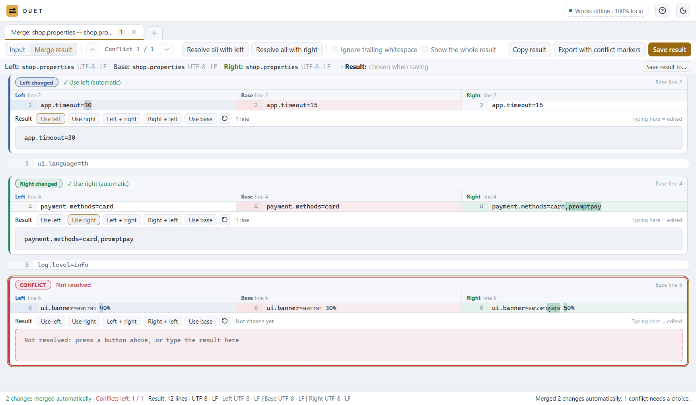
  </picture>
</p>

### Tables

<p align="center">
  <picture>
    <source media="(prefers-color-scheme: dark)" srcset="docs/images/table-dark.png">
    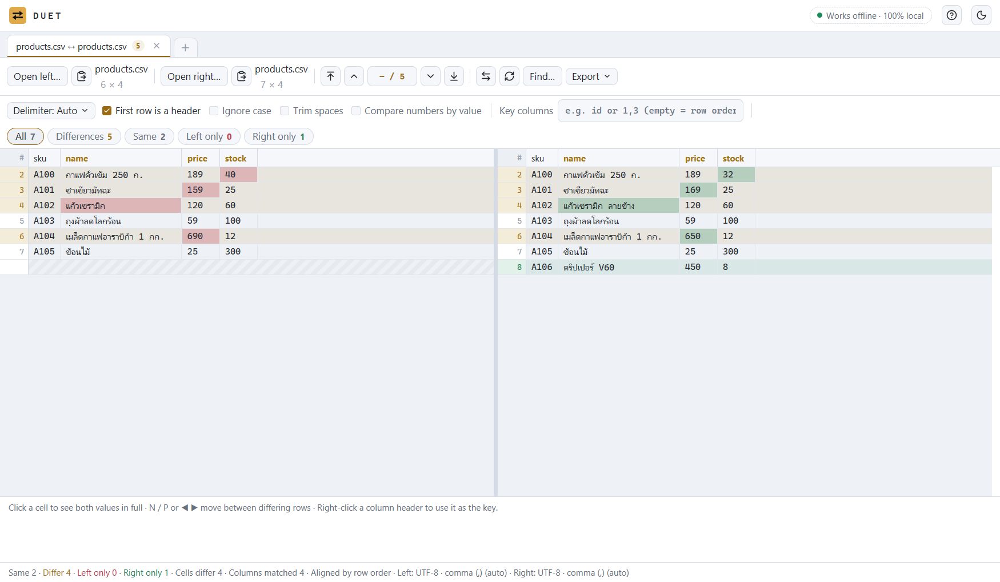
  </picture>
</p>

- CSV and TSV cell by cell; the delimiter is detected (comma, tab, semicolon or pipe).
- Columns pair by header name; **key columns** pair rows by ID even when their order differs.
- Ignore case, trim spaces, and compare numbers by value (so `1.0` equals `1`). Export the differences as CSV or HTML.

### Pictures

<p align="center">
  <picture>
    <source media="(prefers-color-scheme: dark)" srcset="docs/images/picture-dark.png">
    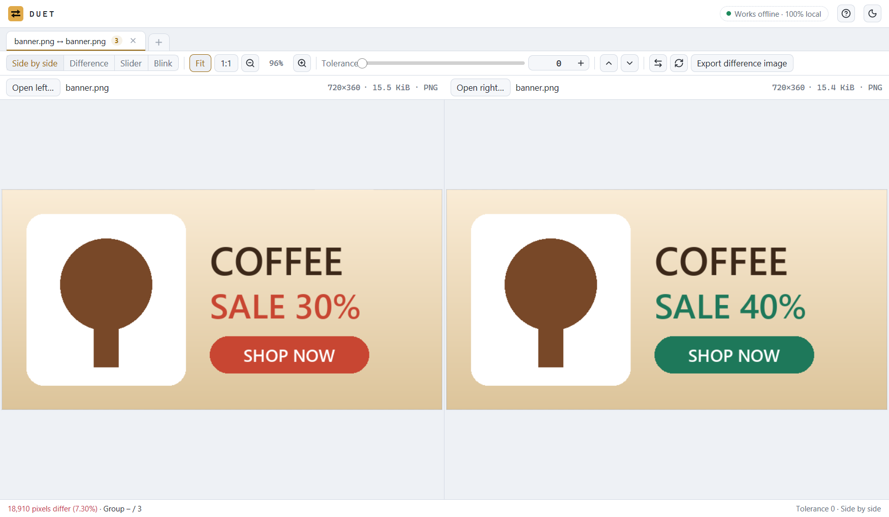
  </picture>
</p>

- PNG, JPEG, GIF, BMP, WebP, ICO, TIFF and SVG, pixel by pixel (a GIF shows its first frame).
- Four views: **side by side, difference** (changed pixels in red), **slider** and **blink**; a tolerance for compression noise; zoom and pan both sides together; export the difference as a PNG.

### Bytes (hex)

<p align="center">
  <picture>
    <source media="(prefers-color-scheme: dark)" srcset="docs/images/hex-dark.png">
    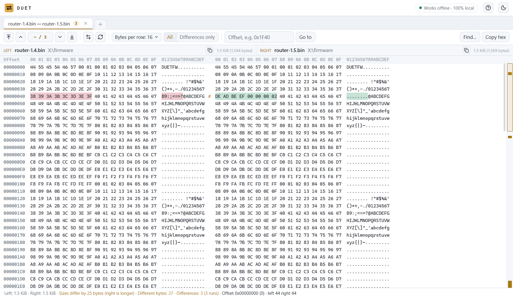
  </picture>
</p>

- Binary files of any size, byte by byte, with 8, 16 or 32 bytes a row, *differences only*, go to an offset, and find hex bytes or text.

## Reports you can hand to someone

Finding the differences is half the job. The other half is telling your team what you found. In a
folder tab, press **Report**, pick a format, and duet writes one file you can send. The person who
gets it does not need duet.

Every format starts the same way. You name the two sides (*PROD* and *UAT* read better than "left"
and "right", and duet remembers the names for that folder pair), add a title and a note such as the
change number, and choose the scope: all items, what the filter shows now, or only what you selected.

| You want to | Use | What the reader gets |
|---|---|---|
| Send the result to someone who just wants to read it | **HTML** | One file that opens in any browser, with no network |
| Track a review as a team, file by file | **Excel (.xlsx)** | Three sheets, with columns for who checked what and the result |
| Paste into a ticket or keep beside a release | **Text (.txt)** | Plain text, readable anywhere |
| Feed another program or your own script | **CSV** | One row per file, ready to filter |

The pictures and samples below come from real reports of the made-up shop release the other pictures on this page use.

### HTML: the one to send

The reader gets the answer before any detail: the counts, a bar showing how much differs, and plain
sentences such as "8 of 11 files do not match". Anything risky gets its own **Needs a closer look**
box. Here that is a Linux script saved with Windows line endings and a file with an invisible
character, two things that are easy to miss in a long list.

<p align="center">
  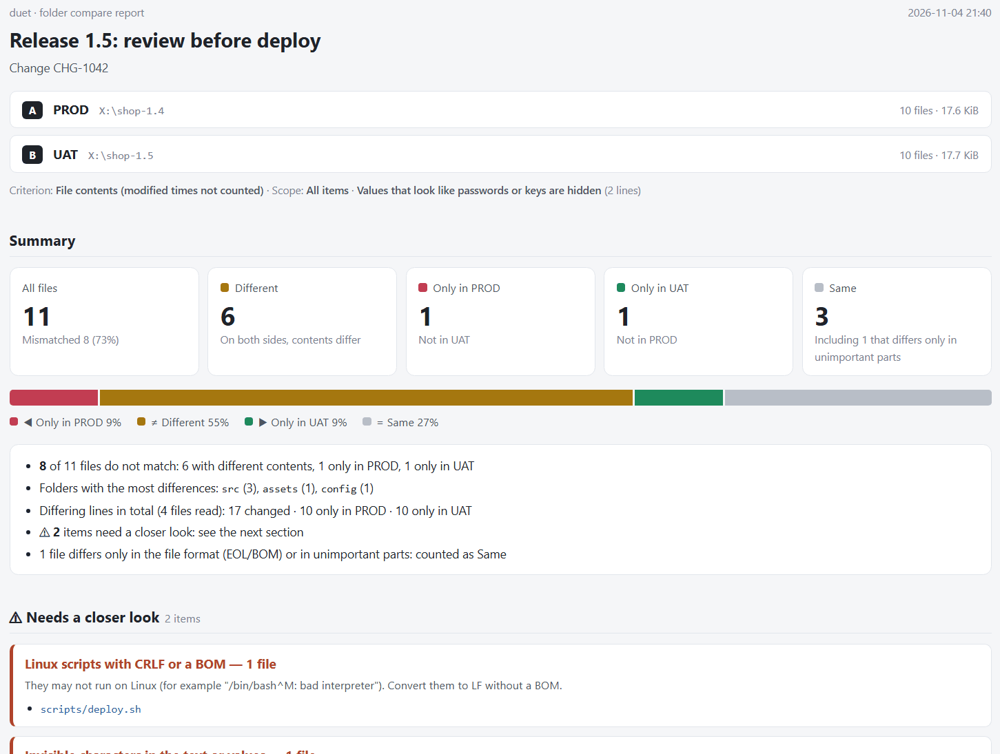
</p>

Further down come a table per folder and then the files. Search by name, tick states on or off, and
click a file to see its differing lines side by side with the changed characters marked.

<p align="center">
  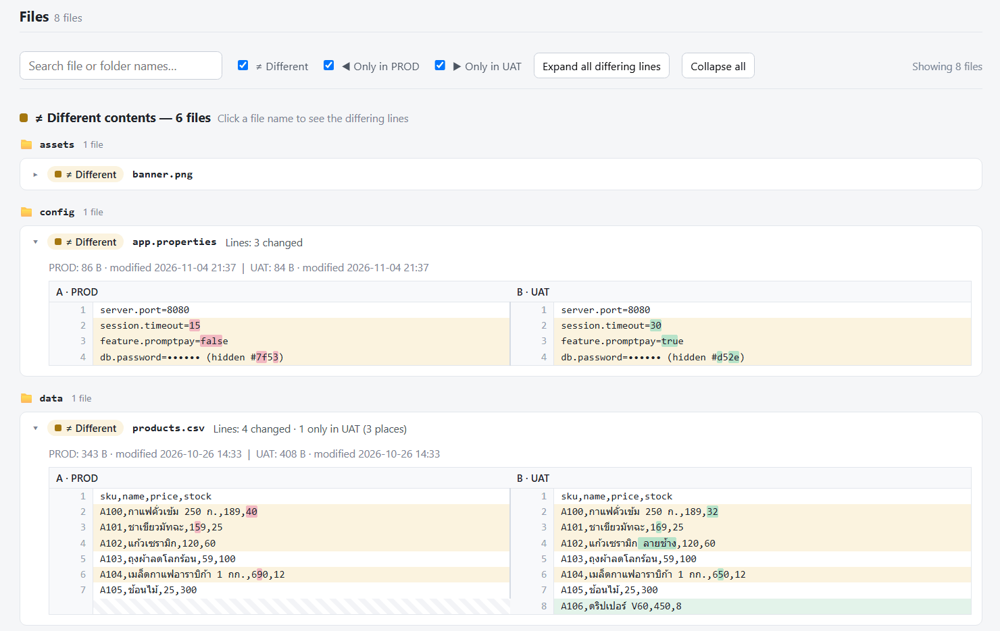
</p>

The styles and scripts are inside the file, so it opens with no network. Press **Ctrl+P** in the
browser to print it or save a PDF; every section opens for the printout.

### Excel: the one to review with

The workbook has three sheets:

- **Summary:** both sides, how the files were compared, and the counts.
- **Files:** one row per file, with a filter on every column and the header and first columns frozen
  as you scroll. The yellow **Reviewer**, **Result** and **Reviewer note** columns are for your team,
  and **Result** offers *Passed, Needs a fix, To review, Not relevant*. A file's name links to its
  rows on the next sheet.
- **Changed lines:** every differing line with both sides next to each other, ready to filter by file.

<p align="center">
  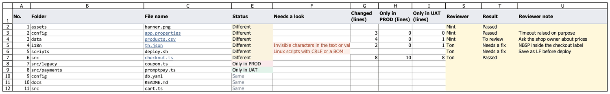
</p>

<p align="center"><sub>The Files sheet after a review. duet writes the rows; the yellow columns were typed in for this picture, and the wide columns (sizes, times, full paths) are hidden so it fits.</sub></p>

<p align="center">
  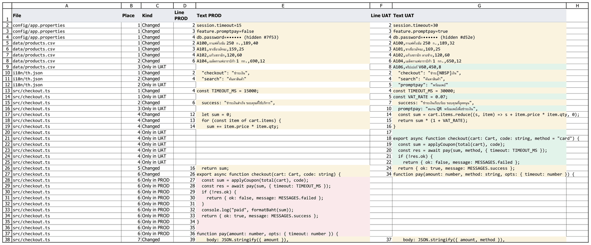
</p>

### Text and CSV: the ones for other tools

The text report reads well in a ticket, an email or a terminal (shortened here):

```text
Folder compare report — Release 1.5: review before deploy
Change CHG-1042
A = PROD : X:\shop-1.4
B = UAT : X:\shop-1.5

Summary
  All files        11   (mismatched 8)
  ≠ Different      6
  < Only in A      1   (PROD)
  > Only in B      1   (UAT)
  = Same           3   (including 1 that differs only in unimportant parts)

Needs a closer look
  [Invisible characters in the text or values] i18n/th.json (UAT)
  [Linux scripts with CRLF or a BOM] scripts/deploy.sh

Details by folder

[config]
  ≠ app.properties   — Lines: 3 changed
        A 1 | B 1: server.port=8080
      ~ A 2: session.timeout=15
      ~ B 2: session.timeout=30
      ~ A 3: feature.promptpay=false
      ~ B 3: feature.promptpay=true
      ~ A 4: db.password=•••••• (hidden #7f53)
      ~ B 4: db.password=•••••• (hidden #d52e)
```

CSV gives one row per file. It carries a BOM and Windows line endings, so Excel reads Thai correctly
(shortened here):

```csv
No.,Folder,File name,Type,Status,Needs a look,Changed (lines),Only in PROD (lines),Only in UAT (lines),…
2,config,app.properties,properties,Different,,3,0,0,…
4,i18n,th.json,json,Different,Invisible characters in the text or values (UAT),2,0,1,…
5,scripts,deploy.sh,sh,Different,Linux scripts with CRLF or a BOM,,,,…
```

### Before a report leaves your team

- **Hide values that look like passwords.** Turn this on before you share. `db.password=…` becomes
  `db.password=•••••• (hidden #7f53)`, private keys are hidden too, and the same value always gets the
  same code, so a reader can still tell that a value changed without seeing it. It guesses from
  names, so read the report before you send it.
- **Show each file's differing lines.** This needs **Content** or the text rules as the criterion,
  because duet has to read the files. **Esc** cancels before anything is written.

Other tabs export too. A text tab offers an HTML report, a patch file (unified diff), a text report,
or the patch on the clipboard. A table tab exports its differences as CSV or an HTML report, and a
picture tab exports a difference image.

## Details that save you a bad day

| You see | It means |
|---|---|
| **≈** on a file | Same content; only the line endings (CRLF / LF), the final newline or a BOM differ. Counted as the same. |
| **⚠** on a script | A `.sh`, `.py` or `#!` file with Windows line endings or a BOM: it may fail on Linux with `bad interpreter`. |
| **⚠ invisible** | The file holds a no-break space, a zero-width character or a direction mark that looks like nothing but changes the value. |
| **⚠** on a name | Two names differ only in case: one file on Windows, two files on Linux. |
| **Blue ↷ 7** | A line that moved; 7 is its line on the other side. |
| **Purple** | A difference your rules call unimportant. It is not counted. |
| **"other time"** | The bytes match, only the modified time differs. Not a difference. |

## Download and install

**[Download the latest release](https://github.com/ball46/duet/releases/latest)** and pick one:

| File | For |
|---|---|
| `duet-<version>-setup-x64.exe` | The installer. Installs for you only, with no administrator prompt (or for all users, if you choose), adds Start menu and optional desktop shortcuts, can put `duet-cli` on your PATH, and uninstalls from *Settings › Apps*. Follows your Windows light or dark setting, in Thai or English. |
| `duet-<version>-portable-x64.zip` | No install: unzip anywhere (a USB drive works) and run `duet.exe`. |
| `SHA256SUMS.txt` | Checksums to confirm the download is intact. |

**Works on** Windows 10 version 1903 or later and Windows 11, on 64-bit Intel and AMD PCs (x64).
Windows 11 on Arm (for example Snapdragon laptops) should run it through Windows' built-in x64
emulation; that is not tested yet, so a card telling how it went is welcome.
No other software is needed. macOS and Linux are not supported yet; see the [roadmap](#roadmap).

> [!IMPORTANT]
> The 0.1 builds are not code-signed yet, so Windows SmartScreen may say *Windows protected your PC*.
> Choose **More info**, check that the file name matches the one you downloaded, then **Run anyway**.
> You can compare the file's SHA-256 with `SHA256SUMS.txt` first: `Get-FileHash .\duet-0.1.0-setup-x64.exe`.

Your settings, the recent list and the theme live in `%LOCALAPPDATA%\duet`. Uninstalling leaves
them, so a reinstall picks up where you left off; delete that folder to start fresh.

## Command line

```text
duet LEFT RIGHT                  compare two files or two folders in the app
duet --table LEFT RIGHT          open two files as tables
duet LEFT RIGHT BASE [OUTPUT]    3-way merge; save the result to OUTPUT if given
```

`duet-cli` compares in a terminal or a script, with no window:

```text
duet-cli LEFT RIGHT [--content] [--ignore-ws edges|all] [--ignore-case] [--ignore-eol]
                    [--include GLOB]... [--exclude GLOB]... [--json] [--quiet] ...
```

It exits with **0** when the two sides are identical, **1** when they differ and **2** on an error,
so a script can act on the result. `duet-cli --help` lists every option, such as the time
tolerance for quick folder compares.

## Build from source

You need Windows 10 or 11 (x64), [Rust](https://rustup.rs/) 1.90 or later with the MSVC toolchain,
and the Windows SDK (for the icon and version resources; the build still works without it).

```powershell
git clone https://github.com/ball46/duet.git
cd duet
cargo build --release -p duet-app -p duet-cli   # target\release\duet.exe and duet-cli.exe
powershell -File scripts\check.ps1              # format, lint and the full test suite
powershell -File scripts\install.ps1            # copy the build to %LOCALAPPDATA%\Programs\duet
```

The installer is built with [Inno Setup](https://jrsoftware.org/isinfo.php) 6.7 or later:
`ISCC.exe installer\duet.iss` writes `dist\duet-<version>-setup-x64.exe`.

<details>
<summary><b>How the code is laid out</b></summary>

| Crate | What it holds |
|---|---|
| `crates/duet-core` | The compare engine, with no UI: folder scan and plans, text diff (patience and Myers, linear space), 3-way merge, encodings, tables, pictures, hex, reports, sync. |
| `crates/duet-app` | The desktop app, built on [gpui](https://www.gpui.rs/) through `gpui-kit`: one tab per compare, the views, the guide. |
| `crates/duet-cli` | `duet-cli`, the terminal front end. |
| `crates/duet-benchgen` | Makes the large files the benchmarks use. |

About 1,750 automated tests cover the engine and the views. `deny.toml` bans HTTP crates and a test
fails if the app ever wires up an HTTP client, so *offline* is checked, not just promised.

</details>

## Report a bug or ask for a feature

Every issue is a card on the [Issues](https://github.com/ball46/duet/issues) page. Write in **English or Thai**, whichever is easier for you.

1. Open **[New issue](https://github.com/ball46/duet/issues/new/choose)** (you need a free GitHub account).
2. Pick a card:
   - **🐞 Bug report**: something is wrong, crashes or looks broken.
   - **✨ Feature request**: something you wish duet did, or did differently.
   - **❓ Question**: not sure how to do something.
3. Fill in the form. For a bug, the steps to make it happen again and your duet version (in *Settings › Apps*, the name of the file you downloaded, or `duet.exe` › *Properties* › *Details*) help the most. Drag a screenshot or a small sample file into the box if you can. **Remove passwords and private data first.**
4. Press **Create**. You will get an e-mail when someone answers, and you can follow the card's label (*bug*, *enhancement*, *question*) as it moves.

Before you write, search the open issues: if your card is already there, add a 👍 to it; that helps decide what comes next.
Found a security problem? Please do not open a public card; see [SECURITY.md](SECURITY.md).

<details>
<summary><b>ภาษาไทย: วิธีแจ้งปัญหาหรือขอฟีเจอร์</b></summary>

ทุกเรื่องที่แจ้งจะเป็นการ์ดหนึ่งใบในหน้า [Issues](https://github.com/ball46/duet/issues) เขียนเป็นภาษาไทยหรืออังกฤษก็ได้

1. เปิด **[New issue](https://github.com/ball46/duet/issues/new/choose)** (ต้องมีบัญชี GitHub ซึ่งสมัครฟรี)
2. เลือกการ์ด
   - **🐞 Bug report** สำหรับสิ่งที่ทำงานผิด โปรแกรมปิดเอง หรือหน้าจอแสดงผิด
   - **✨ Feature request** สำหรับสิ่งที่อยากให้ duet ทำได้ หรืออยากให้ทำต่างจากเดิม
   - **❓ Question** สำหรับคนที่ไม่แน่ใจว่าต้องทำอย่างไร
3. กรอกแบบฟอร์ม ถ้าเป็นบั๊ก ให้บอกขั้นตอนที่ทำให้เกิดซ้ำได้และเวอร์ชันของ duet (ดูได้ใน *Settings › Apps* หรือจากชื่อไฟล์ที่ดาวน์โหลด) แนบภาพหน้าจอหรือไฟล์ตัวอย่างเล็กๆ ได้ด้วยการลากใส่ช่องข้อความ **ลบรหัสผ่านและข้อมูลส่วนตัวออกก่อน**
4. กด **Create** เมื่อมีคนตอบ คุณจะได้รับอีเมลแจ้ง และดูความคืบหน้าได้จากป้ายบนการ์ด (*bug*, *enhancement*, *question*)

ก่อนเขียน ลองค้นการ์ดที่เปิดอยู่ก่อน ถ้ามีเรื่องเดียวกันแล้ว ให้กด 👍 ที่การ์ดนั้นแทน จะช่วยให้รู้ว่าเรื่องไหนควรทำก่อน
ถ้าเจอช่องโหว่ด้านความปลอดภัย อย่าเปิดการ์ดสาธารณะ ให้ดูวิธีแจ้งใน [SECURITY.md](SECURITY.md)

</details>

Want to fix something yourself? See [CONTRIBUTING.md](CONTRIBUTING.md).

## Roadmap

What comes next depends on the cards people open. Ideas so far:

- [ ] Code-signed releases, so SmartScreen stops warning
- [ ] A native Windows on Arm (arm64) build
- [ ] Look inside `.zip` and `.tar` archives, and compare a folder with a saved snapshot of it
- [ ] Compare Excel `.xlsx` sheets directly (today: save as CSV, or paste the cells)
- [ ] Thai word wrapping that never splits a word
- [ ] macOS (needs Command-key shortcuts, Finder and Trash, and a Mac to build and test on)

## FAQ

<details>
<summary><b>Does duet send my files anywhere?</b></summary>

No. duet has no network code: it reads and compares files on your computer only. The build bans
HTTP libraries (`deny.toml`) and a test fails if the app wires up an HTTP client. If you want Windows
to enforce it too, run `scripts\firewall-block.ps1 -BinDir "$env:LOCALAPPDATA\Programs\duet"` as
administrator: it blocks all outbound traffic for `duet.exe` and `duet-cli.exe`.
</details>

<details>
<summary><b>Is it free?</b></summary>

Yes, for any use, under the [MIT License](LICENSE).
</details>

<details>
<summary><b>Why does Windows warn me when I run the installer?</b></summary>

The 0.1 builds are not code-signed yet. See [Download and install](#download-and-install) for how to
check the file and run it.
</details>

<details>
<summary><b>The contents match, yet the files show as different?</b></summary>

The folder compare starts with *Quick (size + time)*, which reads no files, so the same contents
with another time count as different. Choose *Content* from the criterion button.
</details>

<details>
<summary><b>Thai text shows as strange characters?</b></summary>

Click the encoding in that side's file-name bar (such as *UTF-8 · LF*) and choose *Thai
(windows-874)*. duet usually detects it by itself.
</details>

<details>
<summary><b>Where is the full guide?</b></summary>

Inside the app: press **F1**, in Thai or English. It covers every view, the symbols and colours, the
shortcuts and more questions like these.
</details>

## Star history

<a href="https://www.star-history.com/?repos=ball46%2Fduet&amp;type=date">
  <picture>
    <source media="(prefers-color-scheme: dark)" srcset="https://api.star-history.com/chart?repos=ball46/duet&amp;type=date&amp;theme=dark&amp;legend=top-left" />
    <source media="(prefers-color-scheme: light)" srcset="https://api.star-history.com/chart?repos=ball46/duet&amp;type=date&amp;legend=top-left" />
    
  </picture>
</a>

If duet saves you time, a ⭐ helps other people find it.

## License

[MIT](LICENSE) © 2026 ball46. Third-party libraries keep their own licenses; the icons are from
[Lucide](https://lucide.dev/) (ISC License).
