<p align="center">
  <picture>
    <source media="(prefers-color-scheme: dark)" srcset="docs/brand/banner-dark.png">
    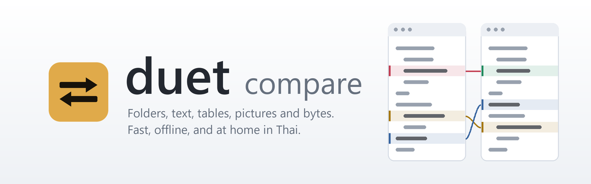
  </picture>
</p>

<p align="center">
  <a href="README.md">English</a> · <b>ภาษาไทย</b>
</p>

<p align="center">
  <b>duet compare คือโปรแกรมเทียบไฟล์บน Windows ที่เร็วและทำงานออฟไลน์ทั้งหมด เทียบได้ทั้งโฟลเดอร์ ข้อความ ตาราง รูปภาพ และไบต์ แบบวางคู่กัน</b><br>
  ดูได้ทันทีว่าสองรุ่น สองไฟล์ตั้งค่า หรือสองโฟลเดอร์ต่างกันตรงไหน รวมงานจากสามเวอร์ชัน<br>
  ซิงก์เฉพาะสิ่งที่เลือก และออกรายงานส่งให้ทีมได้ โดยไม่มีข้อมูลออกจากเครื่องของคุณเลย
</p>

<p align="center">
  
  
  
  
  <a href="LICENSE"></a>
  
</p>

<p align="center">
  <a href="https://github.com/thai-open-tools/duet/releases/latest"><b>⬇ ดาวน์โหลดสำหรับ Windows</b></a> ·
  <a href="#แจ้งปัญหาหรือขอฟีเจอร์">แจ้งบั๊ก</a> ·
  <a href="#แจ้งปัญหาหรือขอฟีเจอร์">ขอฟีเจอร์</a> ·
  <a href="#build-จากซอร์สโค้ด">Build จากซอร์สโค้ด</a>
</p>

<br>

<p align="center">
  <picture>
    <source media="(prefers-color-scheme: dark)" srcset="docs/images/text-dark.png">
    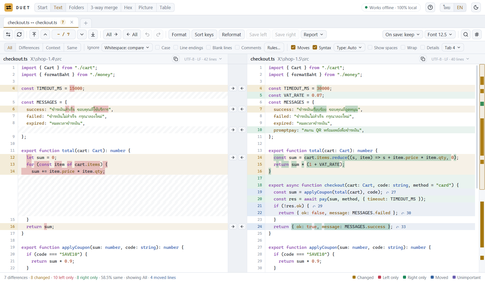
  </picture>
  <br>
  <sub>ไฟล์เดียวกันสองรุ่น สีเหลืองอำพันคือบรรทัดที่เปลี่ยน (ทำเครื่องหมายตัวอักษรที่ต่างไว้) สีแดงและเขียวคือบรรทัดที่มีฝั่งเดียว สีน้ำเงินคือโค้ดที่ย้ายที่</sub>
</p>

<p align="center">
  <a href="#ทำไมต้อง-duet">ทำไมต้อง duet</a> ·
  <a href="#เทียบอะไรได้บ้าง">เทียบอะไรได้บ้าง</a> ·
  <a href="#รายงานที่ส่งต่อให้คนอื่นได้">รายงาน</a> ·
  <a href="#รายละเอียดที่ช่วยกันพลาด">รายละเอียด</a> ·
  <a href="#ดาวน์โหลดและติดตั้ง">ติดตั้ง</a> ·
  <a href="#ใช้ผ่าน-command-line">Command line</a> ·
  <a href="#ใช้-duet-ร่วมกับ-git">Git และ Explorer</a> ·
  <a href="#แจ้งปัญหาหรือขอฟีเจอร์">แจ้งปัญหา</a> ·
  <a href="#คำถามที่พบบ่อย">คำถาม</a>
</p>

<br>

<table>
  <tr>
    <td width="25%" valign="top">
      <h3>📁 โฟลเดอร์</h3>
      เทียบสองโฟลเดอร์ด้วยเวลา ขนาด หรือเนื้อหา กรองได้ คัดลอกได้ ลบไปถังขยะได้ และซิงก์โดยเห็นทุกขั้นตอนก่อนลงมือจริง
    </td>
    <td width="25%" valign="top">
      <h3>📝 ข้อความ</h3>
      เห็นความต่างระดับบรรทัดและตัวอักษร เห็นบรรทัดที่ย้ายที่ ตั้งกฎข้ามสิ่งที่ไม่สำคัญได้ แก้ไขพร้อม undo และรวมสามทางพร้อมจัดการจุดขัดกัน
    </td>
    <td width="25%" valign="top">
      <h3>🧮 ตาราง รูปภาพ ไบต์</h3>
      เทียบ CSV และ TSV ทีละเซลล์โดยจับคู่แถวด้วยคอลัมน์หลักได้ เทียบรูปทีละพิกเซลแบบดูได้สี่แบบ และเทียบไฟล์ binary ขนาดเท่าไรก็ได้แบบ hex
    </td>
    <td width="25%" valign="top">
      <h3>🔒 ออฟไลน์ เร็ว รองรับภาษาไทย</h3>
      ไม่มีโค้ดที่ใช้เครือข่ายเลย เปิดไฟล์ใหญ่ได้เร็ว อ่านภาษาไทยได้ทั้ง UTF-8 และ windows-874 และใช้ได้ทั้งภาษาไทยและอังกฤษ รวมคู่มือและรายงาน
    </td>
  </tr>
</table>

## ทำไมต้อง duet

duet เริ่มจากการใช้ **Beyond Compare** ทำงานทุกวัน และอยากใช้เครื่องมือแบบนี้ได้เต็มที่ ทั้งโฟลเดอร์ ข้อความ ตาราง รูปภาพ และไบต์
ในที่เดียว ตามวิธีทำงานจริง จึงเขียน duet ขึ้นใหม่ทั้งหมด โดยอิงจากประสบการณ์ที่ใช้งานจริง
แล้วเพิ่มสิ่งที่อยากได้มาตลอด เพื่อให้การเทียบ **ทำได้ง่ายขึ้นและอ่านผลได้ชัดขึ้น**

- **แจ้งเตือนผิดน้อยลง** ไฟล์ที่ต่างกันแค่ท้ายบรรทัด (EOL) หรือ BOM จะแสดงเป็น **≈** และนับว่าเหมือนกัน วางเมาส์ไว้จะเห็นว่าฝั่งไหนเป็นแบบไหน
- **เห็นกับดักที่มองไม่เห็น** สคริปต์ Linux ที่บันทึกด้วยท้ายบรรทัดแบบ Windows (CRLF) จะขึ้น **⚠** เพราะอาจรันไม่ได้ ส่วนช่องว่างแบบไม่ตัดบรรทัด อักขระความกว้างศูนย์ และเครื่องหมายทิศทางข้อความ จะมีเครื่องหมาย **⍽** และ **◇** และนับจำนวนให้ ทั้งในไฟล์เดียวและทั้งโฟลเดอร์
- **ชื่อไฟล์ที่ชนกันบน Linux** `Config.xml` กับ `config.xml` เป็นไฟล์เดียวกันบน Windows แต่เป็นสองไฟล์บน Linux duet จับคู่ให้และเตือนไว้
- **เห็นการย้าย ไม่ใช่แค่การลบ** บล็อกที่ย้ายที่จะเป็นสีน้ำเงินพร้อมเลขบรรทัดของอีกฝั่ง คลิกเพื่อกระโดดไปดู หรือลากเพื่อย้ายได้
- **รายงานที่ส่งต่อได้** มีทั้ง HTML, Excel, ข้อความ และ CSV ตั้งชื่อแต่ละฝั่งเองได้ (เช่น *UAT* กับ *PROD*) และซ่อนค่าที่ดูเหมือนรหัสผ่านหรือ private key ก่อนส่งออกนอกทีม
- **อ่านแผนซิงก์ได้ก่อนลงมือ** ทุกการคัดลอกและการลบจะแสดงเป็นรายการก่อนกดเริ่ม และไฟล์ที่ลบจะไปอยู่ในถังขยะ
- **ภาษาไทยถูกต้อง** ตรวจจับและแสดงข้อความภาษาไทยทั้ง UTF-8 และ windows-874 ได้ถูกต้อง และทั้งโปรแกรม คู่มือ และรายงาน ใช้ได้ทั้งภาษาไทยและอังกฤษ ทีละภาษา

**ที่มาของชื่อ** duet แปลว่าการร้องหรือบรรเลงคู่ สองคนเล่นเพลงเดียวกัน ซึ่งตรงกับแนวคิดของโปรแกรมนี้
คือวางสองฝั่งไว้คู่กัน เพื่อให้เห็นทันทีว่าแยกจากกันตรงไหน ชื่อเต็มคือ **duet compare** จะได้รู้เลยว่าทำอะไร ส่วนคำสั่งยังสั้นเหมือนเดิม แค่ `duet LEFT RIGHT`

> [!NOTE]
> duet เป็นโปรเจกต์ open source ที่ทำขึ้นอย่างอิสระและเขียนโค้ดใหม่ทั้งหมด ไม่มีส่วนเกี่ยวข้อง ไม่ได้รับการรับรอง
> และไม่มีความเชื่อมโยงใดๆ กับ Scooter Software และไม่มีโค้ดของ Beyond Compare อยู่เลย
> Beyond Compare เป็นเครื่องหมายการค้าของ Scooter Software

## เทียบอะไรได้บ้าง

duet เลือกมุมมองให้เอง ถ้าเป็นสองโฟลเดอร์จะเปิดหน้าเทียบโฟลเดอร์ สองรูปจะเปิดหน้าเทียบรูป ไฟล์ binary จะเปิดแบบ hex
นอกนั้นจะเปิดหน้าเทียบข้อความ จะลากสองรายการมาวางที่ไหนก็ได้บนหน้าต่าง พิมพ์ path สองอัน หรือเลือกการ์ดในแท็บเริ่มต้น (Start) ก็ได้

<p align="center">
  <picture>
    <source media="(prefers-color-scheme: dark)" srcset="docs/images/home-dark.png">
    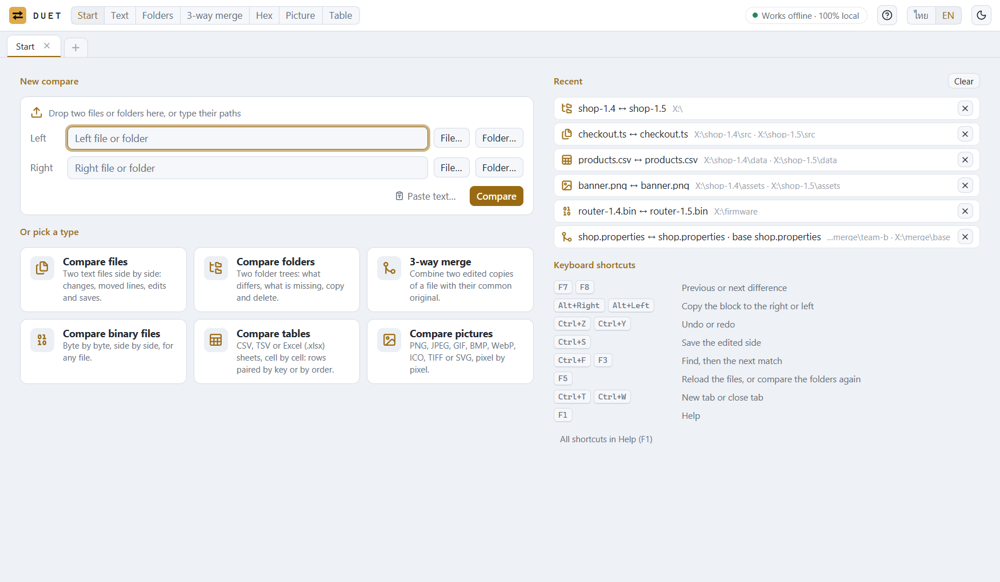
  </picture>
</p>

### โฟลเดอร์

<p align="center">
  <picture>
    <source media="(prefers-color-scheme: dark)" srcset="docs/images/folder-dark.png">
    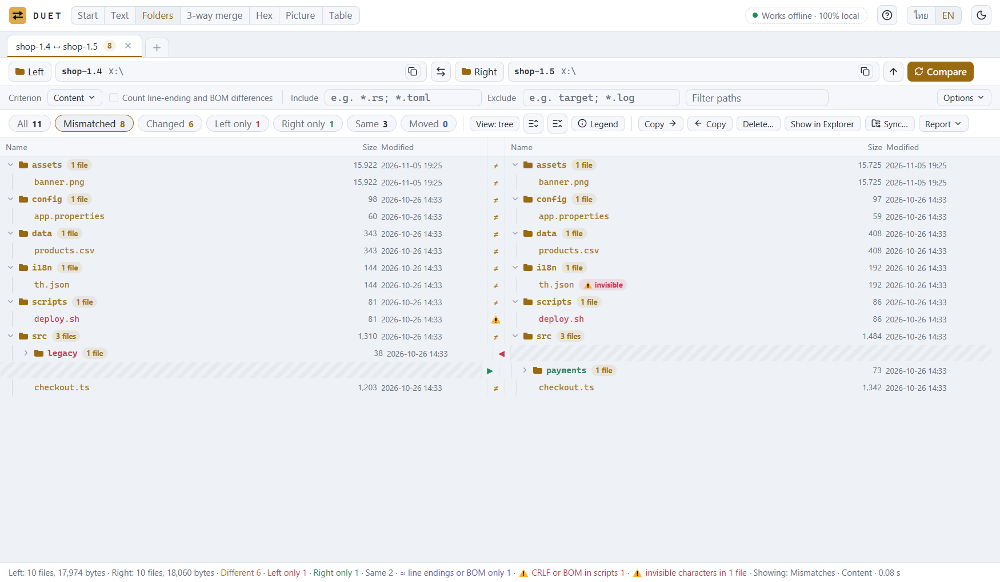
  </picture>
</p>

- เลือกวิธีตัดสินว่าสองไฟล์เหมือนกันได้สี่แบบ คือ **Quick** (ดูขนาดและเวลา ไม่อ่านไฟล์), **Content** (เทียบไบต์), **Size only** หรือ **Content by the text compare rules** (ใช้กฎของหน้าเทียบข้อความ ไฟล์ที่ต่างแค่ส่วนที่ตั้งให้ข้ามจะแสดงเป็น ≈)
- **ไฟล์ที่ย้าย** ไฟล์ที่มีเฉพาะฝั่งซ้ายกับไฟล์ที่มีเฉพาะฝั่งขวา ถ้าไบต์ตรงกันจะติดแท็กว่าย้าย (เมื่อเกณฑ์อ่านเนื้อหา) ทั้งสองแถวอยู่ที่เดิมและมีแท็กบอก path ของอีกฝั่ง คลิกแท็กเพื่อกระโดดไปที่นั่น ปิดได้ที่ *หาไฟล์ที่ย้าย* ในเมนูตัวเลือก
- มีปุ่มกรองแถว **All, Mismatched, Changed, Left only, Right only, Moved, Same** ดูแบบต้นไม้หรือรายการเรียบที่เรียงได้ทุกคอลัมน์ และนับจำนวนไฟล์ให้ทุกโฟลเดอร์
- กรองด้วย mask แบบรวมและยกเว้น (`*.xml; target; /web.config`) ค้น path ได้ และเลือก *Exclude this item* จากเมนูคลิกขวาได้
- คัดลอกได้ทั้งสองทาง (เก็บเวลาแก้ไขไว้เหมือนเดิม) ลบไปถังขยะ ตั้งเวลาไฟล์ และ **ซิงก์** ได้ห้าแบบ คือ **Update right / left / both** (อัปเดตขวา ซ้าย หรือทั้งสองฝั่ง) และ **Mirror to right / left** (มิเรอร์ไปขวาหรือซ้าย) พร้อมดูตัวอย่างทุกขั้นตอนก่อน
- ออก **รายงาน** เป็น HTML, Excel (.xlsx มีคอลัมน์ *Result* ไว้ให้ทีมตรวจ), ข้อความ และ CSV ใส่บรรทัดที่ต่างของแต่ละไฟล์ได้ด้วย [ดูตัวอย่างแต่ละแบบ](#รายงานที่ส่งต่อให้คนอื่นได้)

### ข้อความ และการรวมสามทาง

- เห็นความต่างทีละบรรทัดและทีละตัวอักษร มีแถบภาพรวมที่คลิกหรือลากได้ และสลับดูได้ทั้งทุกบรรทัด เฉพาะที่ต่าง ที่ต่างพร้อมบรรทัดรอบข้าง หรือเฉพาะที่เหมือน
- **ข้ามสิ่งที่ไม่สำคัญ** ได้ ทั้งช่องว่าง (ห้าแบบ) ตัวพิมพ์เล็กใหญ่ ท้ายบรรทัด บรรทัดว่าง comment ตามภาษาของไฟล์ และ regular expression ที่ตั้งเองสำหรับวันที่ GUID หรือเลขเวอร์ชัน ส่วนที่ข้ามจะเป็นสีม่วงและไม่นับเป็นความต่าง
- แก้ไขได้ทั้งสองฝั่งพร้อม undo และ redo คัดลอกบล็อกข้ามฝั่ง ค้นหาและแทนที่ด้วย regular expression ไปที่บรรทัด เลือก encoding และท้ายบรรทัดที่จะเขียนตอนบันทึก และโหลดใหม่เมื่อโปรแกรมอื่นแก้ไฟล์
- ระบายสีโค้ดได้ 17 ภาษา เช่น Rust, TypeScript, Python, Go, Java, C#, SQL, YAML และ PowerShell
- **รวมสามทาง (3-way merge)** สำหรับไฟล์สองชุดที่แก้มาจากต้นฉบับเดียวกัน การเปลี่ยนที่มีฝั่งเดียวจะถูกรับเข้าเอง ส่วนจุดที่ขัดกันเลือกได้ว่าจะใช้ *ซ้าย*, *ขวา*, *ซ้าย + ขวา*, *ขวา + ซ้าย* หรือ *ต้นฉบับ* หรือพิมพ์ผลลัพธ์เอง

<p align="center">
  <picture>
    <source media="(prefers-color-scheme: dark)" srcset="docs/images/merge-dark.png">
    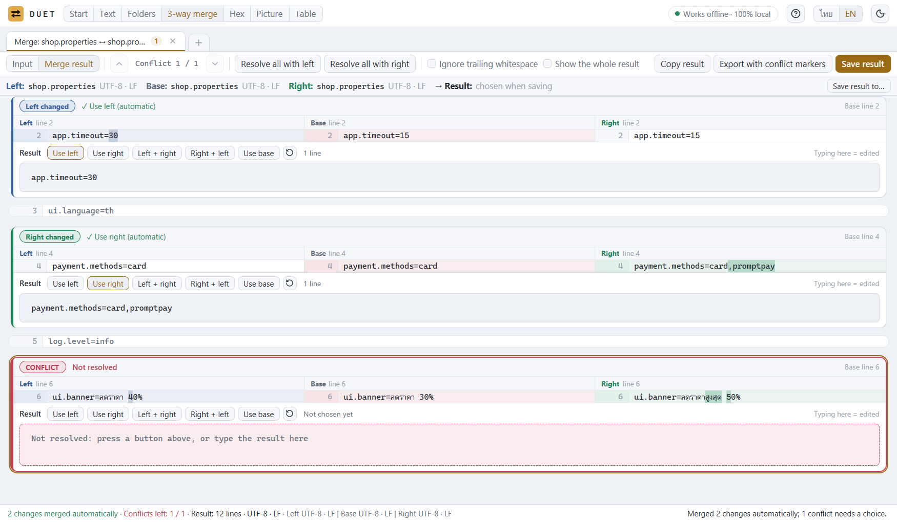
  </picture>
</p>

### ตาราง

<p align="center">
  <picture>
    <source media="(prefers-color-scheme: dark)" srcset="docs/images/table-dark.png">
    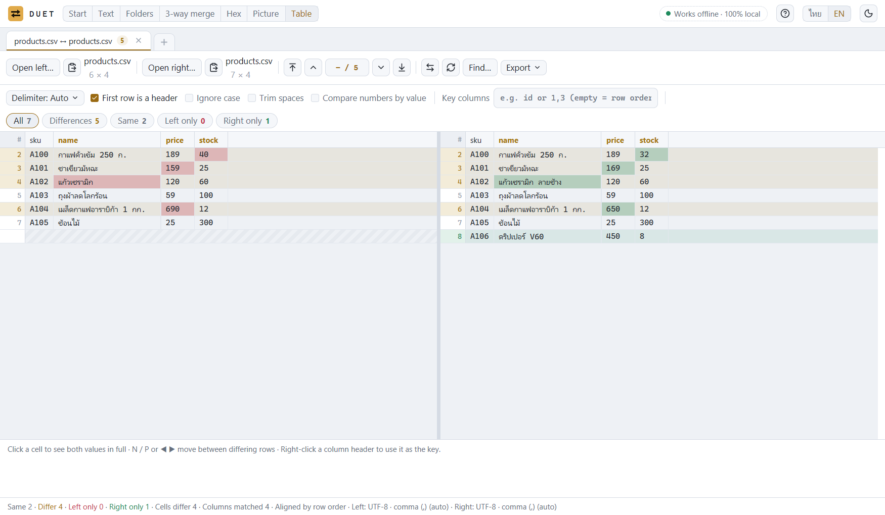
  </picture>
</p>

- เทียบ CSV และ TSV ทีละเซลล์ ตรวจหาตัวคั่นให้เอง (จุลภาค แท็บ อัฒภาค หรือ |)
- จับคู่คอลัมน์ด้วยชื่อหัวตาราง และใช้ **Key columns** (คอลัมน์หลัก) จับคู่แถวด้วยรหัสได้ แม้ลำดับแถวจะต่างกัน
- ข้ามตัวพิมพ์เล็กใหญ่ ตัดช่องว่าง และเทียบตัวเลขตามค่า (`1.0` เท่ากับ `1`) ส่งออกความต่างเป็น CSV หรือ HTML ได้
- เปิด Excel `.xlsx` และ `.xlsm` แบบอ่านอย่างเดียว เลือกชีตของแต่ละฝั่งได้ และสูตรเทียบด้วยผลลัพธ์ที่บันทึกไว้ เซลล์แสดงค่าที่เก็บไว้จริง ไม่ใช่ตามรูปแบบของ Excel (เซลล์ 25% จะเห็นเป็น `0.25`) และวันที่แสดงเป็นข้อความแบบ ISO (`2024-03-05`) ถ้าทั้งสองฝั่งเป็นไฟล์ Excel ข้อความที่หน้าตาเหมือนตัวเลขหรือวันที่จะมีเครื่องหมาย `'` นำหน้า เหมือนที่ Excel เขียนเอง ข้อความ `1` จึงต่างจากตัวเลข `1` ส่วนเมื่อเทียบกับไฟล์ CSV จะไม่มี `'` เพราะ CSV ไม่แยกชนิดของเซลล์
- duet ไม่บันทึกกลับเป็น `.xlsx` ส่งออกได้เป็น CSV หรือ HTML เท่านั้น และการเทียบโฟลเดอร์ยังเทียบไบต์ของไฟล์ Excel ซึ่ง Excel เขียนใหม่ทุกครั้งที่บันทึก ให้เปิดคู่ไฟล์เป็นตารางเพื่อดูว่าเซลล์ต่างกันจริงหรือไม่

### รูปภาพ

<p align="center">
  <picture>
    <source media="(prefers-color-scheme: dark)" srcset="docs/images/picture-dark.png">
    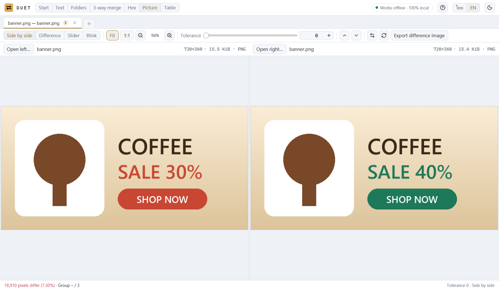
  </picture>
</p>

- PNG, JPEG, GIF, BMP, WebP, ICO, TIFF และ SVG เทียบทีละพิกเซล (GIF แสดงเฉพาะเฟรมแรก)
- ดูได้สี่แบบ คือ **Side by side** (วางคู่กัน), **Difference** (พิกเซลที่ต่างเป็นสีแดง), **Slider** (เลื่อนแถบเทียบ) และ **Blink** (สลับภาพไปมา) ตั้งค่าความคลาดเคลื่อนที่ยอมรับได้สำหรับรูปที่บีบอัด ซูมและเลื่อนทั้งสองฝั่งพร้อมกัน และบันทึกภาพความต่างเป็น PNG ได้

### ไบต์ (hex)

<p align="center">
  <picture>
    <source media="(prefers-color-scheme: dark)" srcset="docs/images/hex-dark.png">
    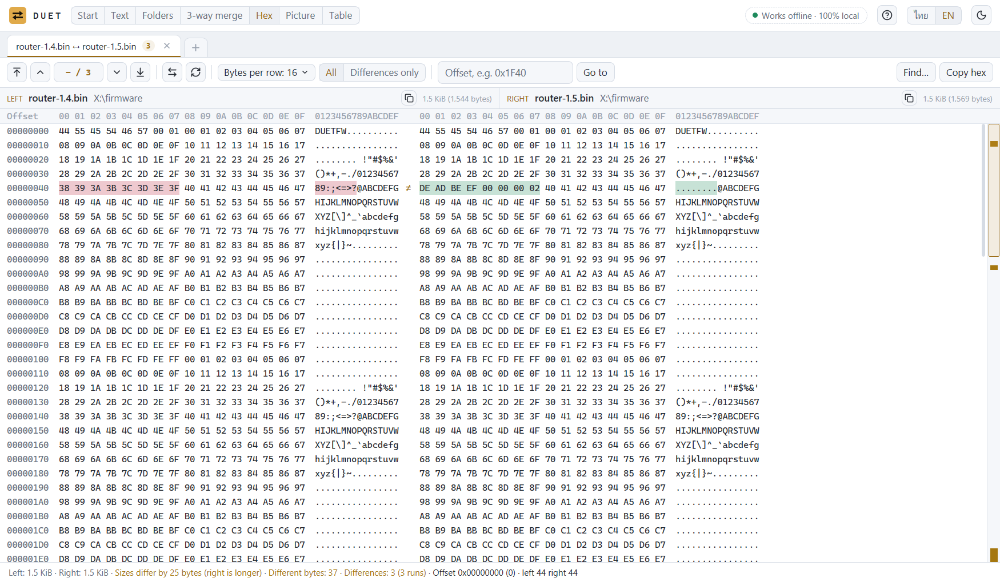
  </picture>
</p>

- เทียบไฟล์ binary ขนาดเท่าไรก็ได้ทีละไบต์ เลือกแถวละ 8, 16 หรือ 32 ไบต์ ดูเฉพาะที่ต่าง ไปที่ offset ที่ต้องการ และค้นหาด้วยไบต์ hex หรือข้อความได้

## รายงานที่ส่งต่อให้คนอื่นได้

หาความต่างได้เป็นแค่ครึ่งเดียวของงาน อีกครึ่งคือบอกทีมว่าเจออะไร ในแท็บโฟลเดอร์ กด **รายงาน** (Report) เลือกรูปแบบ
แล้ว duet จะเขียนออกมาเป็นไฟล์เดียวที่ส่งต่อได้เลย คนรับไม่ต้องมี duet

ทุกแบบเริ่มเหมือนกัน คือตั้งชื่อสองฝั่งเอง (*PROD* กับ *UAT* อ่านเข้าใจกว่า "ซ้าย" กับ "ขวา" และ duet จำชื่อไว้ให้คู่โฟลเดอร์นั้น)
ใส่หัวข้อกับหมายเหตุ เช่น เลขที่ CR แล้วเลือกขอบเขตว่าจะเอาทุกรายการ เฉพาะที่กรองอยู่ หรือเฉพาะที่เลือกไว้

| อยากทำอะไร | ใช้แบบไหน | คนรับจะได้อะไร |
|---|---|---|
| ส่งผลให้คนที่แค่อยากอ่าน | **HTML** | ไฟล์เดียว เปิดได้ทุกเบราว์เซอร์ ไม่ต้องต่อเน็ต |
| ตรวจเป็นทีมทีละไฟล์ แล้วติดตามผล | **Excel (.xlsx)** | สามชีต มีคอลัมน์ว่าใครตรวจอะไรและผลเป็นอย่างไร |
| วางใน ticket หรือเก็บไว้คู่กับรุ่นที่ปล่อย | **ข้อความ (.txt)** | ข้อความธรรมดา เปิดอ่านได้ทุกที่ |
| ส่งต่อให้โปรแกรมอื่นหรือสคริปต์ที่เขียนเอง | **CSV** | ไฟล์ละหนึ่งแถว กรองต่อได้ทันที |

รูปและตัวอย่างด้านล่างมาจากรายงานจริงของรุ่นร้านค้าสมมติชุดเดียวกับรูปอื่นในหน้านี้

**ภาษาไทยหรืออังกฤษ** ตัวโปรแกรมและรายงานมีทั้งสองภาษา ใช้ทีละภาษา กด `ไทย | EN` ที่หัวหน้าต่างเพื่อสลับทั้งโปรแกรมทันที
ส่วนรายงานเลือกภาษาของตัวเองได้ ที่ **ภาษาของรายงาน** ในหน้าตั้งค่ารายงานของแท็บโฟลเดอร์ และในเมนูรายงานของแท็บข้อความกับแท็บตาราง
หน้าจอภาษาไทยจึงเขียนรายงานภาษาอังกฤษได้ และกลับกันก็ได้ ตัวอย่างด้านล่างเป็นภาษาอังกฤษ รายงานภาษาไทยมีหน้าตาแบบเดียวกัน
แต่ชื่อคอลัมน์และคำบอกสถานะเป็นภาษาไทย ถ้ามีสคริปต์มาอ่านไฟล์ ให้เลือก English

### HTML: แบบที่เอาไว้ส่ง

คนอ่านเห็นคำตอบก่อนรายละเอียด ทั้งตัวเลขสรุป แถบบอกสัดส่วนความต่าง และประโยคอย่าง "8 of 11 files do not match" (8 จาก 11 ไฟล์ไม่ตรงกัน)
ส่วนเรื่องที่เสี่ยงจะแยกไว้ในกล่อง **Needs a closer look** ในตัวอย่างนี้คือสคริปต์ Linux ที่บันทึกด้วยท้ายบรรทัดแบบ Windows
กับไฟล์ที่มีอักขระมองไม่เห็น ซึ่งเป็นสองเรื่องที่พลาดง่ายเมื่อต้องไล่ดูรายการยาว ๆ

<p align="center">
  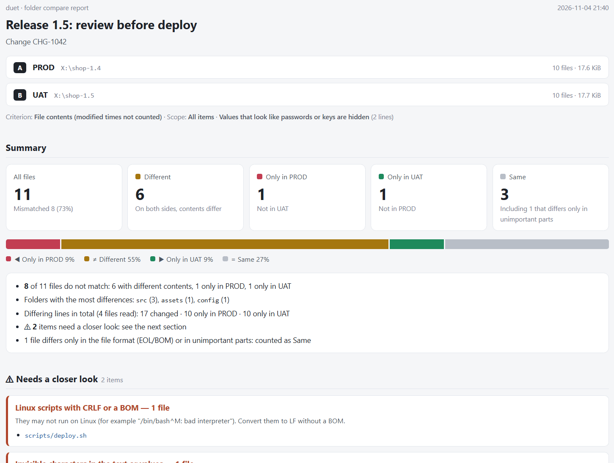
</p>

ถัดลงไปเป็นตารางแยกตามโฟลเดอร์และรายการไฟล์ ค้นจากชื่อได้ เลือกเปิดปิดตามสถานะได้
และคลิกที่ไฟล์เพื่อดูบรรทัดที่ต่างแบบเทียบข้างกัน พร้อมไฮไลต์ตัวอักษรที่เปลี่ยน

<p align="center">
  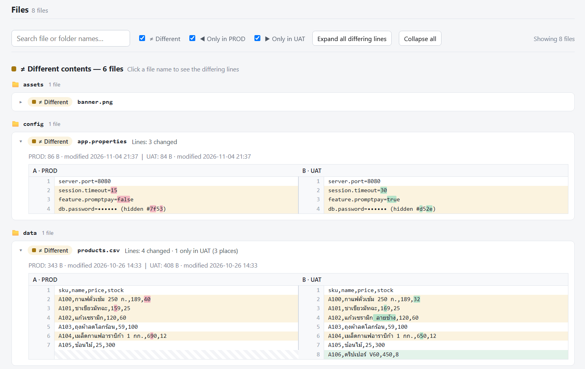
</p>

สไตล์และสคริปต์อยู่ในไฟล์เดียวกันหมด จึงเปิดได้โดยไม่ต้องต่อเน็ต กด **Ctrl+P** ในเบราว์เซอร์เพื่อพิมพ์หรือบันทึกเป็น PDF
ได้เลย ตอนพิมพ์ทุกส่วนจะกางออกให้เอง

### Excel: แบบที่เอาไว้ตรวจเป็นทีม

สมุดงานมีสามชีต:

- **Summary:** ข้อมูลสองฝั่ง วิธีที่ใช้เทียบ และตัวเลขสรุป
- **Files:** ไฟล์ละหนึ่งแถว ทุกคอลัมน์มีตัวกรอง หัวตารางและคอลัมน์แรก ๆ ถูกตรึงไว้เวลาเลื่อน คอลัมน์สีเหลือง **Reviewer**, **Result** และ **Reviewer note** มีไว้ให้ทีมกรอก
  ช่อง **Result** เลือกได้จาก *Passed, Needs a fix, To review, Not relevant* ส่วนชื่อไฟล์เป็นลิงก์ไปยังแถวของไฟล์นั้นในชีตถัดไป
- **Changed lines:** ทุกบรรทัดที่ต่าง วางสองฝั่งติดกัน กรองตามไฟล์ได้ทันที

<p align="center">
  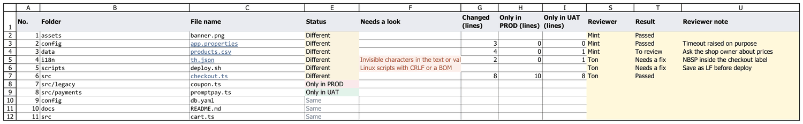
</p>

<p align="center"><sub>ชีต Files หลังตรวจเสร็จ duet เขียนแถวให้ ส่วนคอลัมน์สีเหลืองพิมพ์เพิ่มเพื่อทำรูปนี้ และซ่อนคอลัมน์กว้าง ๆ (ขนาด เวลา path เต็ม) ไว้ให้รูปพอดี</sub></p>

<p align="center">
  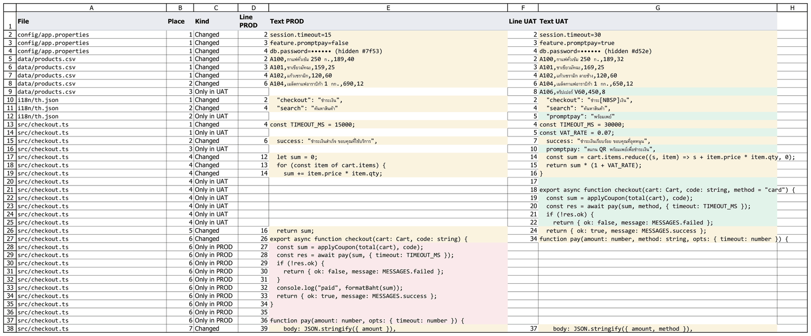
</p>

### ข้อความและ CSV: แบบที่เอาไว้ใช้กับเครื่องมืออื่น

รายงานข้อความอ่านง่ายทั้งใน ticket อีเมล และ terminal (ตัดให้สั้นลง):

```text
Folder compare report — Release 1.5: review before deploy
Change CHG-1042
A = PROD : X:\shop-1.4
B = UAT : X:\shop-1.5

Summary
  All files        11   (mismatched 8)
  ≠ Different      6
  < Only in A      1   (PROD)
  > Only in B      1   (UAT)
  = Same           3   (including 1 that differs only in unimportant parts)

Needs a closer look
  [Invisible characters in the text or values] i18n/th.json (UAT)
  [Linux scripts with CRLF or a BOM] scripts/deploy.sh

Details by folder

[config]
  ≠ app.properties   — Lines: 3 changed
        A 1 | B 1: server.port=8080
      ~ A 2: session.timeout=15
      ~ B 2: session.timeout=30
      ~ A 3: feature.promptpay=false
      ~ B 3: feature.promptpay=true
      ~ A 4: db.password=•••••• (hidden #7f53)
      ~ B 4: db.password=•••••• (hidden #d52e)
```

CSV มีหนึ่งแถวต่อไฟล์ มี BOM และท้ายบรรทัดแบบ Windows เปิดใน Excel แล้วภาษาไทยแสดงถูกต้อง (ตัดให้สั้นลง):

```csv
No.,Folder,File name,Type,Status,Needs a look,Changed (lines),Only in PROD (lines),Only in UAT (lines),…
2,config,app.properties,properties,Different,,3,0,0,…
4,i18n,th.json,json,Different,Invisible characters in the text or values (UAT),2,0,1,…
5,scripts,deploy.sh,sh,Different,Linux scripts with CRLF or a BOM,,,,…
```

### ก่อนส่งรายงานออกนอกทีม

- **ซ่อนค่าที่ดูเหมือนรหัสผ่าน** (*Hide values that look like passwords*) ควรเปิดไว้ก่อนส่ง `db.password=…` จะกลายเป็น
  `db.password=•••••• (hidden #7f53)` private key ก็ถูกซ่อนเช่นกัน และค่าเดียวกันจะได้รหัสเดียวกันเสมอ คนอ่านจึงรู้ว่าค่าเปลี่ยนไปโดยไม่เห็นค่าจริง
  แต่ duet เดาจากชื่อ จึงควรอ่านรายงานอีกรอบก่อนส่ง
- **แสดงบรรทัดที่ต่างของแต่ละไฟล์** (*Show each file's differing lines*) ต้องใช้เกณฑ์ **เนื้อหา** (Content) หรือเกณฑ์ตามกฎข้อความ
  เพราะ duet ต้องอ่านไฟล์ กด **Esc** เพื่อยกเลิกได้ก่อนจะเขียนไฟล์

แท็บอื่นก็ส่งออกได้เช่นกัน แท็บข้อความมีรายงาน HTML, ไฟล์ patch (unified diff), รายงานข้อความ หรือคัดลอก patch ไปคลิปบอร์ด
แท็บตารางส่งออกความต่างเป็น CSV หรือรายงาน HTML และแท็บรูปส่งออกเป็นภาพความต่างได้

## รายละเอียดที่ช่วยกันพลาด

| ถ้าเห็น | หมายความว่า |
|---|---|
| **≈** ที่ไฟล์ | เนื้อหาเหมือนกัน ต่างแค่ท้ายบรรทัด (CRLF / LF) การขึ้นบรรทัดท้ายไฟล์ หรือ BOM นับว่าเหมือนกัน |
| **⚠** ที่สคริปต์ | ไฟล์ `.sh`, `.py` หรือไฟล์ที่ขึ้นต้นด้วย `#!` ที่มีท้ายบรรทัดแบบ Windows หรือ BOM อาจรันบน Linux ไม่ได้ และขึ้น `bad interpreter` |
| **⚠ invisible** | ในไฟล์มีช่องว่างแบบไม่ตัดบรรทัด อักขระความกว้างศูนย์ หรือเครื่องหมายทิศทาง ที่มองไม่เห็นแต่ทำให้ค่าเปลี่ยน |
| **⚠** ที่ชื่อ | ชื่อสองชื่อต่างกันแค่ตัวพิมพ์เล็กใหญ่ เป็นไฟล์เดียวบน Windows แต่เป็นสองไฟล์บน Linux |
| **สีน้ำเงิน ↷ 7** | บรรทัดที่ย้ายที่ เลข 7 คือบรรทัดของมันในอีกฝั่ง |
| **สีม่วง** | ความต่างที่กฎของคุณบอกว่าไม่สำคัญ ไม่นับเป็นความต่าง |
| **"other time"** | ไบต์ตรงกันทุกตัว ต่างแค่เวลาแก้ไข ไม่นับเป็นความต่าง |

## ดาวน์โหลดและติดตั้ง

**[ดาวน์โหลดรุ่นล่าสุด](https://github.com/thai-open-tools/duet/releases/latest)** แล้วเลือกไฟล์ที่ต้องการ

| ไฟล์ | ใช้สำหรับ |
|---|---|
| `duet-<version>-setup-x64.exe` | ตัวติดตั้ง ติดตั้งให้เฉพาะผู้ใช้คนปัจจุบันโดยไม่ต้องใช้สิทธิ์ admin (หรือเลือกติดตั้งให้ทุกคนก็ได้) สร้าง shortcut ในเมนู Start และบนหน้าจอ (ถ้าเลือก) เพิ่ม `duet-cli` ลงใน PATH ได้ และถอนการติดตั้งได้จาก *Settings › Apps* หน้าตัวติดตั้งจะสว่างหรือมืดตามที่ตั้งไว้ใน Windows และมีทั้งภาษาไทยและอังกฤษ |
| `duet-<version>-portable-x64.zip` | ไม่ต้องติดตั้ง แตกไฟล์ไว้ที่ไหนก็ได้ (ใน USB ก็ได้) แล้วเปิด `duet.exe` |
| `SHA256SUMS.txt` | ค่า checksum สำหรับตรวจว่าไฟล์ที่ดาวน์โหลดมาครบและไม่ถูกแก้ |

**ใช้ได้กับ** Windows 10 รุ่น 1903 ขึ้นไป และ Windows 11 บนเครื่องที่ใช้ชิป Intel หรือ AMD แบบ 64 บิต (x64)
Windows 11 บนชิป ARM (เช่นโน้ตบุ๊ก Snapdragon) น่าจะเปิดได้ผ่านระบบจำลอง x64 ที่มีมาใน Windows แต่ยังไม่ได้ทดสอบ
ถ้าใครลองแล้ว เปิด issue เล่าผลให้ฟังได้
ไม่ต้องลงโปรแกรมอื่นเพิ่ม ตอนนี้ยังไม่รองรับ macOS และ Linux ดูแผนได้ที่ [แผนงาน](#แผนงาน)

> [!IMPORTANT]
> รุ่นปัจจุบันยังไม่มีลายเซ็นดิจิทัล Windows SmartScreen จึงอาจขึ้นว่า *Windows protected your PC*
> ให้กด **More info** ตรวจว่าชื่อไฟล์ตรงกับที่ดาวน์โหลดมา แล้วกด **Run anyway**
> ตรวจค่า SHA-256 กับไฟล์ `SHA256SUMS.txt` ก่อนก็ได้ ด้วยคำสั่ง `Get-FileHash .\duet-0.2.0-setup-x64.exe`

การตั้งค่า รายการล่าสุด และธีม เก็บไว้ที่ `%LOCALAPPDATA%\duet` การถอนการติดตั้งจะไม่ลบโฟลเดอร์นี้
ติดตั้งใหม่เมื่อไรก็ใช้ต่อได้ทันที ถ้าอยากเริ่มใหม่ทั้งหมดให้ลบโฟลเดอร์นี้

## ใช้ผ่าน command line

```text
duet LEFT RIGHT                  เปิดเทียบสองไฟล์หรือสองโฟลเดอร์ในโปรแกรม
duet --table LEFT RIGHT          เปิดสองไฟล์แบบตาราง
duet LEFT RIGHT BASE [OUTPUT]    รวมสามทาง และบันทึกผลลง OUTPUT ถ้าระบุไว้
duet --select-left PATH          จำ PATH ไว้เป็นฝั่งซ้าย แล้วปิดตัวเองทันที (ไม่เปิดหน้าต่าง)
duet --compare-to PATH           เทียบ PATH กับฝั่งซ้ายที่จำไว้
duet --register-shell            เพิ่มเมนูคลิกขวาใน Explorer ให้ duet.exe ตัวนี้
duet --unregister-shell          เอาเมนูนั้นออก
```

สี่คำสั่งท้ายคือสิ่งที่หัวข้อ [git และ Explorer](#ใช้-duet-ร่วมกับ-git) ด้านล่างใช้
คำสั่งเหล่านี้ไม่แสดงอะไรเลย เพราะ `duet.exe` ไม่มีหน้าต่าง console `--register-shell` และ `--unregister-shell`
จึงบอกผลผ่านรหัสออกเท่านั้น (0 คือสำเร็จ 1 คือล้มเหลว) และบันทึกไว้ใน log ที่ `%LOCALAPPDATA%\duet\logs`

`duet-cli` ใช้เทียบใน terminal หรือในสคริปต์ โดยไม่เปิดหน้าต่าง

```text
duet-cli LEFT RIGHT [--content] [--ignore-ws edges|all] [--ignore-case] [--ignore-eol]
                    [--include GLOB]... [--exclude GLOB]... [--json] [--quiet] ...
```

คำสั่งนี้จบด้วยรหัส **0** เมื่อสองฝั่งเหมือนกัน **1** เมื่อต่างกัน และ **2** เมื่อเกิดข้อผิดพลาด สคริปต์จึงใช้ผลนี้ต่อได้
ดูตัวเลือกทั้งหมดได้ด้วย `duet-cli --help` เช่น ค่าเวลาที่ยอมให้คลาดได้ตอนเทียบโฟลเดอร์แบบ Quick

## ใช้ duet ร่วมกับ git

ใส่ค่านี้ใน `.gitconfig`

```ini
[diff]
    tool = duet
[difftool "duet"]
    cmd = duet "$LOCAL" "$REMOTE"
[difftool]
    prompt = false
[merge]
    tool = duet
[mergetool "duet"]
    cmd = duet "$LOCAL" "$REMOTE" "$BASE" "$MERGED"
    trustExitCode = false
[mergetool]
    keepBackup = false
```

จากนั้น `git difftool` จะเปิด duet เทียบไฟล์ที่แก้ และ `git mergetool` จะเปิดการรวมสามทางเมื่อมี conflict
โดยผลลัพธ์จะถูกบันทึกลงไฟล์ที่ git กำลังรวมอยู่

- **ต้องเรียก `duet` จาก PATH ได้** ตัวติดตั้งมีตัวเลือก *เพิ่ม duet-cli ลงใน PATH* ให้ (ปิดไว้ตั้งแต่แรก
  โดยจะเพิ่มโฟลเดอร์ที่ติดตั้ง ซึ่งมี `duet.exe` อยู่ด้วย) ถ้าไม่ใช้ตัวเลือกนี้ ให้ใส่ path เต็มของ `duet.exe`
  แทนคำว่า `duet` ในสองบรรทัด `cmd`
- `prompt = false` ทำให้ git ไม่ถามก่อนเปิดแต่ละไฟล์ `keepBackup = false` ทำให้ git ไม่ทิ้งไฟล์สำรอง `.orig`
  ไว้หลังรวมเสร็จ `trustExitCode = false` ทำให้ git ตรวจว่าคุณบันทึกแล้วหรือยัง
  ถ้าปิดหน้าต่างโดยไม่บันทึก git จะบอกว่าไฟล์ดูเหมือนไม่เปลี่ยนและถามว่ารวมสำเร็จหรือไม่
  ให้ตอบ `n` เพราะ `y` จะทำให้ git ถือว่าไฟล์แก้เสร็จแล้วทั้งที่เครื่องหมาย conflict ยังอยู่
  หลังกด *Save result* git จะทำงานต่อโดยไม่ถามอะไร
- ที่ลองกับ git for Windows และ duet ที่ติดตั้งแล้ว: `git difftool` กับไฟล์ที่แก้ กับชื่อไฟล์ที่มีช่องว่างและตัวอักษรไทย
  และกับ `--dir-diff` (เปิดเทียบโฟลเดอร์หนึ่งหน้าต่าง) `git mergetool` กับ conflict ที่มีต้นฉบับร่วม
  และที่ไม่มี (สองประวัติที่ไม่เกี่ยวกัน) *Use left* และ *Save result* เขียนไฟล์ที่รวมแล้ว และ git ทำงานต่อได้
  git จะรอจนกว่าจะปิดหน้าต่าง

## ใช้ duet จาก Explorer

มีสองคำสั่งในเมนูคลิกขวาของไฟล์และโฟลเดอร์

- **Select as left** จำรายการนั้นไว้เป็นฝั่งซ้าย ไม่แสดงอะไรเลย ทั้งหน้าต่าง เสียง และข้อความ
  จะรู้ว่าสำเร็จก็ตอนที่คำสั่งถัดไปเปิดขึ้นมา
- **Compare to selected left** เทียบรายการที่จำไว้กับรายการที่คลิก แล้วลืมรายการที่จำไว้
  ทุกครั้งที่ใช้จะเปิด **duet หน้าต่างใหม่** ไม่ได้เพิ่มแท็บในหน้าต่างที่เปิดอยู่แล้ว

ถ้ายังไม่ได้จำอะไรไว้ หรือรายการที่จำไว้ถูกลบไปแล้ว duet จะเปิดแท็บเริ่มต้นโดยใส่รายการนี้ไว้ในช่องฝั่งซ้าย
(กรณีถูกลบ จะมีบรรทัดบอกชื่อที่หายไป) ถ้าเทียบไฟล์กับโฟลเดอร์ จะขึ้นข้อความเดิมว่า "Cannot compare a file with a folder."
และเมนูนี้จะไม่แสดงเมื่อเลือกหลายรายการพร้อมกัน

- **ตัวติดตั้ง:** ตัวเลือก *เพิ่ม "เลือกเป็นฝั่งซ้าย" และ "เทียบกับฝั่งซ้ายที่เลือกไว้" ในเมนูคลิกขวาของ Explorer*
  เปิดไว้ตั้งแต่แรก และเมื่อถอนการติดตั้งจะเอาเมนูออกให้ ไม่ต้องมี shell extension
  ถ้าติดตั้งแบบผู้ใช้คนเดียว เมนูจะเป็นของบัญชีของคุณเท่านั้นและไม่ต้องใช้สิทธิ์ admin
  ถ้าติดตั้งแบบทุกคน เมนูจะเป็นของทุกบัญชี `--unregister-shell` เอาออกเฉพาะเมนูของบัญชีคุณ
  ดังนั้นเมนูของการติดตั้งแบบทุกคนจะหายไปตอนถอนการติดตั้ง การลงทะเบียนแบบผู้ใช้คนเดียวมีลำดับก่อน
  แบบทุกคน และการถอนการติดตั้งแบบผู้ใช้คนเดียวจะเอาเมนูของตัวแบบพกพาออกไปด้วย เพราะใช้ชื่อคีย์เดียวกัน ตัวติดตั้งภาษาไทยจะใช้ชื่อเมนูเป็นภาษาไทย
- **ไฟล์ zip แบบพกพา:** รัน `.\duet --register-shell` หนึ่งครั้งจากโฟลเดอร์ที่เก็บ `duet.exe` และรัน
  `.\duet --unregister-shell` ก่อนลบโฟลเดอร์นั้น ถ้าย้าย `duet.exe` ต้องลงทะเบียนใหม่
  ตัวที่ติดตั้งกับตัวแบบพกพาใช้ชื่อเมนูเดียวกัน ตัวที่ลงทะเบียนทีหลังจะเป็นตัวที่ทำงาน
- **Windows 11:** เมนูนี้อยู่ใต้ **Show more options** (หรือกด Shift+F10) ซึ่งเป็นเมนูแบบเดิม
  เมนูสั้นแบบใหม่รับเฉพาะรายการจากแพ็กเกจแอปที่มีลายเซ็น และ duet ยังไม่มีลายเซ็น

## Build จากซอร์สโค้ด

ต้องมี Windows 10 หรือ 11 (x64), [Rust](https://rustup.rs/) 1.90 ขึ้นไปที่ใช้ toolchain แบบ MSVC และ Windows SDK
(ใช้ใส่ไอคอนและข้อมูลเวอร์ชันให้ไฟล์ exe ถ้าไม่มีก็ยัง build ได้)

```powershell
git clone https://github.com/thai-open-tools/duet.git
cd duet
cargo build --release -p duet-app -p duet-cli   # ได้ target\release\duet.exe และ duet-cli.exe
powershell -File scripts\check.ps1              # ตรวจรูปแบบโค้ด lint และรัน test ทั้งหมด
powershell -File scripts\install.ps1            # คัดลอกไปไว้ที่ %LOCALAPPDATA%\Programs\duet
```

ตัวติดตั้งสร้างด้วย [Inno Setup](https://jrsoftware.org/isinfo.php) 6.7 ขึ้นไป
คำสั่ง `ISCC.exe installer\duet.iss` จะได้ไฟล์ `dist\duet-<version>-setup-x64.exe`

<details>
<summary><b>โครงสร้างของโค้ด</b></summary>

| Crate | มีอะไรอยู่ |
|---|---|
| `crates/duet-core` | ส่วนที่ใช้เทียบ ไม่มีหน้าจอ ได้แก่ การสแกนโฟลเดอร์และแผนการคัดลอก การเทียบข้อความ (patience และ Myers แบบใช้หน่วยความจำเชิงเส้น) รวมสามทาง encoding ตาราง รูปภาพ hex รายงาน และซิงก์ |
| `crates/duet-app` | ตัวโปรแกรมบนเดสก์ท็อป สร้างด้วย [gpui](https://www.gpui.rs/) ผ่าน `gpui-kit` แต่ละการเทียบเปิดเป็นหนึ่งแท็บ มีหน้าจอแต่ละแบบและคู่มือในโปรแกรม |
| `crates/duet-cli` | `duet-cli` สำหรับใช้ใน terminal |
| `crates/duet-benchgen` | สร้างไฟล์ขนาดใหญ่ที่ใช้วัดความเร็ว |

มี test อัตโนมัติราว 1,750 ข้อ ครอบคลุมทั้งส่วนที่ใช้เทียบและหน้าจอ `deny.toml` ห้ามใช้ crate ที่ทำ HTTP
และมี test ที่ไม่ผ่านถ้าโปรแกรมตั้งค่า HTTP client ไว้ คำว่า *ออฟไลน์* จึงถูกตรวจจริง ไม่ใช่แค่สัญญา

</details>

## แจ้งปัญหาหรือขอฟีเจอร์

ทุกเรื่องที่แจ้งจะเป็น issue หนึ่งใบ (เหมือนการ์ดหนึ่งใบ) ในหน้า [Issues](https://github.com/thai-open-tools/duet/issues) เขียนเป็น **ภาษาไทยหรืออังกฤษ** ก็ได้

1. เปิด **[New issue](https://github.com/thai-open-tools/duet/issues/new/choose)** (ต้องมีบัญชี GitHub ซึ่งสมัครฟรี)
2. เลือกแบบฟอร์ม
   - **🐞 Bug report · แจ้งบั๊ก** สำหรับสิ่งที่ทำงานผิด โปรแกรมปิดเอง หรือหน้าจอแสดงผิด
   - **✨ Feature request · ขอฟีเจอร์** สำหรับสิ่งที่อยากให้ duet ทำได้ หรืออยากให้ทำต่างจากเดิม
   - **❓ Question · คำถาม** สำหรับคนที่ไม่แน่ใจว่าต้องทำอย่างไร
3. กรอกแบบฟอร์ม ซึ่งมีคำอธิบายทั้งภาษาไทยและอังกฤษ ถ้าเป็นบั๊ก ให้บอกขั้นตอนที่ทำให้เกิดซ้ำได้และเวอร์ชันของ duet
   (ดูได้ใน *Settings › Apps* จากชื่อไฟล์ที่ดาวน์โหลด หรือคลิกขวาที่ `duet.exe` › *Properties* › *Details*)
   แนบภาพหน้าจอหรือไฟล์ตัวอย่างเล็กๆ ได้ด้วยการลากใส่ช่องข้อความ **ลบรหัสผ่านและข้อมูลส่วนตัวออกก่อน**
4. กด **Create** เมื่อมีคนตอบ คุณจะได้รับอีเมลแจ้ง และดูความคืบหน้าได้จากป้ายบน issue (*bug*, *enhancement*, *question*)

ก่อนเขียน ลองค้น issue ที่เปิดอยู่ก่อน ถ้ามีเรื่องเดียวกันแล้ว ให้กด 👍 ที่ issue นั้นแทน จะช่วยให้รู้ว่าเรื่องไหนควรทำก่อน
ถ้าเจอช่องโหว่ด้านความปลอดภัย อย่าเปิด issue สาธารณะ ให้ดูวิธีแจ้งใน [SECURITY.md](SECURITY.md)

<details>
<summary><b>English: how to report a bug or ask for a feature</b></summary>

Every issue is a card on the [Issues](https://github.com/thai-open-tools/duet/issues) page. Write in **English or Thai**, whichever is easier for you.

1. Open **[New issue](https://github.com/thai-open-tools/duet/issues/new/choose)** (you need a free GitHub account).
2. Pick a form:
   - **🐞 Bug report**: something is wrong, crashes or looks broken.
   - **✨ Feature request**: something you wish duet did, or did differently.
   - **❓ Question**: not sure how to do something.
3. Fill in the form; its labels are in both English and Thai. For a bug, the steps to make it happen again and your duet version (in *Settings › Apps*, the name of the file you downloaded, or `duet.exe` › *Properties* › *Details*) help the most. Drag a screenshot or a small sample file into the box if you can. **Remove passwords and private data first.**
4. Press **Create**. You will get an e-mail when someone answers, and you can follow the issue's label (*bug*, *enhancement*, *question*) as it moves.

Before you write, search the open issues: if yours is already there, add a 👍 to it. Security problems go through [SECURITY.md](SECURITY.md), not a public issue.

</details>

อยากแก้หรือเพิ่มอะไรเองก็ได้ ดูวิธีใน [CONTRIBUTING.md](CONTRIBUTING.md)

## ใช้งานอะไรได้บ้างตอนนี้

| | ใช้ได้ตอนนี้ | ยังไม่มี |
|---|---|---|
| **โฟลเดอร์** | ตัดสินว่าตรงกันได้สี่แบบ แบบต้นไม้หรือรายการเรียบ คัดลอก ลบลงถังขยะ ซิงก์ห้าโหมด รายงาน HTML, Excel, ข้อความ และ CSV | หาไฟล์ที่ย้ายได้เฉพาะเมื่อเกณฑ์อ่านเนื้อหา และโฟลเดอร์ที่ย้ายจะติดแท็กทีละไฟล์ ยังเปิดดูข้างในไฟล์ `.zip` และ `.tar` ไม่ได้ |
| **ข้อความ** | ความต่างระดับบรรทัดและตัวอักษร กฎที่ไม่นับ แก้ไฟล์ ค้นและแทนที่ encoding การรวมสามทาง และปุ่ม **เรียงคีย์** สำหรับ JSON และ YAML (ลำดับ key ที่เปลี่ยนไม่นับเป็นความต่าง) | มุมมองเรียงคีย์แก้ไม่ได้ ไม่แสดงคอมเมนต์ของ YAML เลขบรรทัดเป็นของข้อความที่เรียงแล้ว และยังไม่เรียง XML |
| **ตาราง** | CSV, TSV และ Excel `.xlsx` / `.xlsm` (หนึ่งชีตต่อฝั่ง อ่านอย่างเดียว) เทียบทีละเซลล์ คอลัมน์ key | ยังไม่อ่าน `.xls` และ `.xlsb` ไม่บันทึกกลับเป็น `.xlsx` ไฟล์ Excel ที่มีฝั่งเดียวในการเทียบโฟลเดอร์จะเปิดเป็นข้อความ รูปแบบในตัวหมายเลข 71 ถึง 81 ซึ่งเป็นวันที่และเวลาที่ Excel ภาษาไทยบันทึกไว้ จะอ่านเป็นเลขลำดับของวัน และเซลล์ปฏิทินไทยที่ใช้รูปแบบวันที่อื่นจะอ่านเป็นวันที่แบบสากล ISO (2024-03-05 ส่วน Excel แสดง 2567) |
| **รูปภาพและไบต์** | เทียบรูปทีละพิกเซลสี่มุมมอง เทียบไบต์แบบ hex | |
| **เริ่มจากที่อื่น** | command line, `duet-cli`, git difftool และ mergetool, เมนูคลิกขวาใน Explorer | บน Windows 11 เมนูใน Explorer อยู่ใต้ *Show more options* |
| **ภาษา** | ตัวโปรแกรม คู่มือ F1 และรายงาน มีทั้งภาษาไทยและอังกฤษ ใช้ทีละภาษา ตัวติดตั้งก็มีสองภาษา และแสดงข้อความภาษาไทยได้ถูกต้อง | |
| **ใช้ได้บน** | Windows 10 (1903 ขึ้นไป) และ Windows 11 แบบ x64 | ยังไม่ได้ทดสอบบน Windows ARM และยังไม่มี macOS กับ Linux |

## แผนงาน

สิ่งที่จะทำต่อขึ้นกับ issue ที่ทุกคนเปิดเข้ามา ไอเดียที่มีตอนนี้

- [ ] รุ่นที่มีลายเซ็นดิจิทัล เพื่อให้ SmartScreen ไม่เตือน
- [ ] รุ่นที่ build สำหรับ Windows บนชิป ARM (arm64) โดยตรง
- [ ] เปิดดูข้างในไฟล์ `.zip` และ `.tar` และเทียบโฟลเดอร์กับภาพที่บันทึกไว้ (snapshot)
- [ ] อ่านไฟล์ Excel เก่า `.xls` และ `.xlsb` และเปิดไฟล์ Excel ที่มีฝั่งเดียวในการเทียบโฟลเดอร์
- [ ] ตัดบรรทัดภาษาไทยโดยไม่ตัดกลางคำ
- [ ] macOS (ต้องปรับปุ่มลัดให้ใช้ Command, ใช้ Finder และ Trash และต้องมีเครื่อง Mac ไว้ build และทดสอบ)

## คำถามที่พบบ่อย

<details>
<summary><b>duet ส่งไฟล์ของฉันไปที่ไหนหรือเปล่า</b></summary>

ไม่ส่ง duet ไม่มีโค้ดที่ใช้เครือข่ายเลย อ่านและเทียบไฟล์บนเครื่องของคุณเท่านั้น ตอน build จะห้ามใช้ library ที่ทำ HTTP
(`deny.toml`) และมี test ที่ไม่ผ่านถ้าโปรแกรมมีการตั้งค่า HTTP client ถ้าอยากให้ Windows บังคับซ้ำอีกชั้น ให้รัน
`scripts\firewall-block.ps1 -BinDir "$env:LOCALAPPDATA\Programs\duet"` ด้วยสิทธิ์ admin
คำสั่งนี้จะบล็อกการเชื่อมต่อขาออกทั้งหมดของ `duet.exe` และ `duet-cli.exe`
</details>

<details>
<summary><b>ใช้ฟรีไหม</b></summary>

ฟรี ใช้ได้ทุกกรณี ภายใต้สัญญาอนุญาต [MIT](LICENSE)
</details>

<details>
<summary><b>ทำไม Windows ขึ้นเตือนตอนเปิดตัวติดตั้ง</b></summary>

รุ่นปัจจุบันยังไม่มีลายเซ็นดิจิทัล ดูวิธีตรวจไฟล์และเปิดใช้งานได้ที่ [ดาวน์โหลดและติดตั้ง](#ดาวน์โหลดและติดตั้ง)
</details>

<details>
<summary><b>เนื้อหาเหมือนกัน แต่ทำไมขึ้นว่าไฟล์ต่างกัน</b></summary>

หน้าเทียบโฟลเดอร์เริ่มต้นด้วย *Quick (size + time)* ซึ่งไม่อ่านเนื้อไฟล์ ไฟล์ที่เนื้อหาเหมือนกันแต่เวลาไม่ตรงกันจึงนับว่าต่าง
ให้เลือก *Content* จากปุ่มเลือกวิธีเทียบ
</details>

<details>
<summary><b>ภาษาไทยขึ้นเป็นตัวอักษรแปลกๆ</b></summary>

คลิกชื่อ encoding ในแถบชื่อไฟล์ของฝั่งนั้น (เช่น *UTF-8 · LF*) แล้วเลือก *Thai (windows-874)* ปกติ duet จะตรวจจับให้เอง
</details>

<details>
<summary><b>คู่มือฉบับเต็มอยู่ที่ไหน</b></summary>

อยู่ในโปรแกรม กด **F1** อ่านได้ทั้งภาษาไทยและอังกฤษ มีครบทุกหน้า ทั้งความหมายของสัญลักษณ์และสี ปุ่มลัด และคำถามอื่นๆ
</details>

## ประวัติจำนวนดาว

<a href="https://www.star-history.com/?repos=thai-open-tools%2Fduet&amp;type=date">
  <picture>
    <source media="(prefers-color-scheme: dark)" srcset="https://api.star-history.com/chart?repos=thai-open-tools/duet&amp;type=date&amp;theme=dark&amp;legend=top-left" />
    <source media="(prefers-color-scheme: light)" srcset="https://api.star-history.com/chart?repos=thai-open-tools/duet&amp;type=date&amp;legend=top-left" />
    
  </picture>
</a>

ถ้า duet ช่วยประหยัดเวลาให้คุณได้ กด ⭐ ให้หน่อย จะช่วยให้คนอื่นเจอโปรเจกต์นี้ง่ายขึ้น

## สัญญาอนุญาต

[MIT](LICENSE) © 2026 ball46 ส่วน library ของผู้อื่นใช้สัญญาอนุญาตของตัวเอง ไอคอนมาจาก [Lucide](https://lucide.dev/) (สัญญาอนุญาต ISC)
